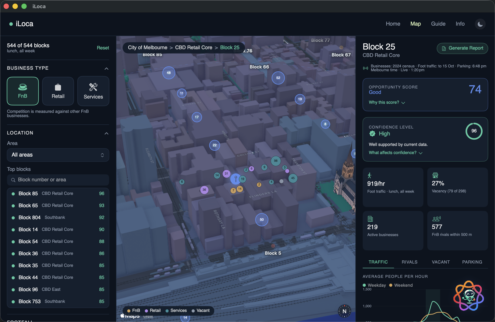
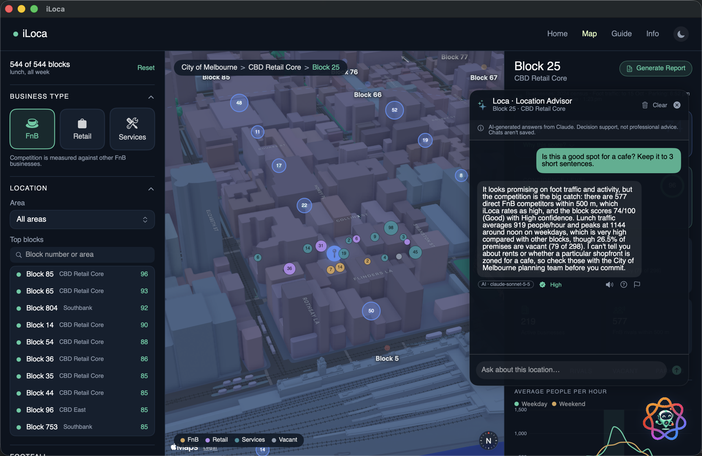
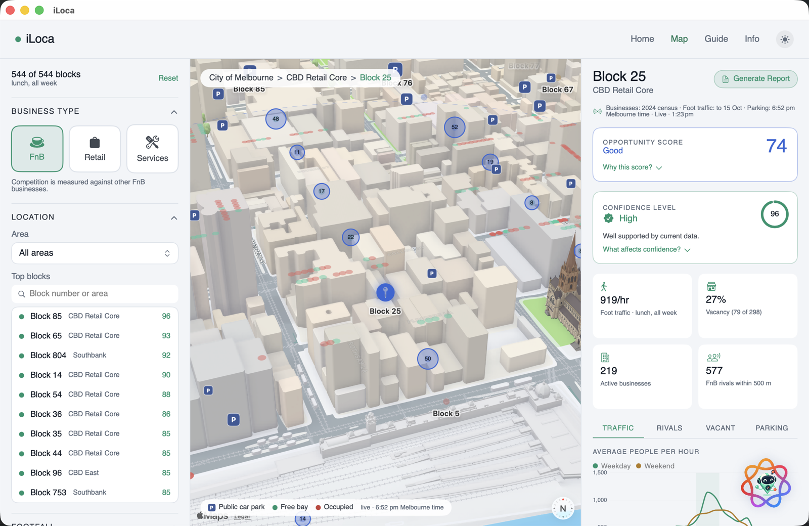
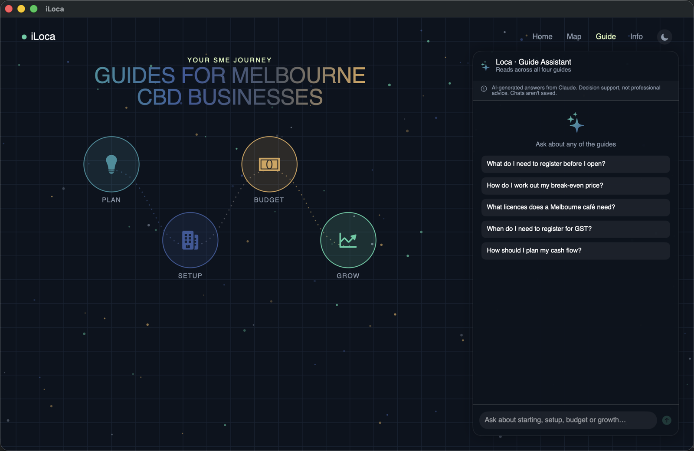
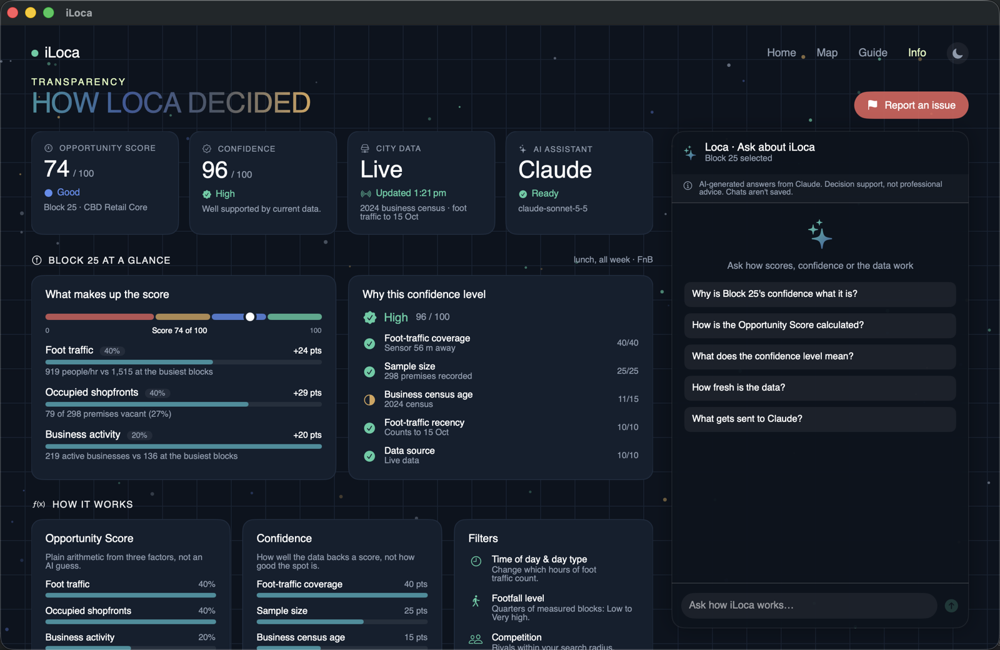
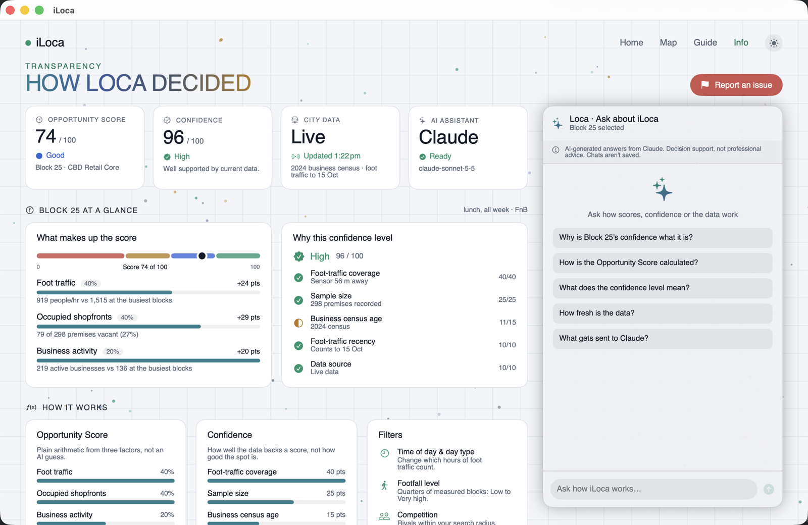

# iLoca

**Find the right place. Build with confidence.**

iLoca is a macOS app that helps first-time small business owners in Melbourne choose where to open. It pulls live City of Melbourne open data into one map and scores every city block. An AI assistant, Loca, explains what the numbers mean in plain language.

---

## Screenshots

| | |
|---|---|
| **Home** | **Map**: 3D block map, filters and the block panel |
|  |  |
| **Loca on the Map**: grounded answer with AI label, confidence, read-aloud, "How Loca decided" and report flag | **Light mode**: with public car parks and live on-street bays |
|  |  |
| **Guide**: assistant over four official business guides | **Info**: transparency dashboard |
|  |  |
| **Info, light mode** | |
|  | |

For how everything works, with diagrams and worked examples, see **[docs.md](docs.md)**.

## Why

One in four Australian businesses doesn't survive its first year, and half close within three. Choosing a location usually means juggling property sites, competitor maps and foot-traffic reports in separate browser tabs. iLoca puts that research in one place and shows how each conclusion was reached.

## Features

### Map
- **Every City of Melbourne block** on a 3D map, coloured by **Opportunity Score** (0–100).
- **Block panel**:
  - Opportunity Score with a "Why this score?" breakdown
  - **Confidence level** (High / Medium / Low) and what it's based on
  - Tabs: Traffic, Rivals, Vacant and Parking
- **Real foot traffic**: hourly pedestrian averages over the last 28 days, split into weekdays and weekends.
- **Competition** by business type (FnB, Retail, Services) within a radius you choose, shown as direct, indirect or all businesses.
- **Named businesses and vacant premises** for every block, plotted on the map.
- **Parking**: public car parks with capacity, and live on-street bay availability from in-ground sensors.
- **Filters**:
  - business type, area, time of day, day type, footfall level, competitor type, search radius and competition preference
  - time of day and day type change which hours of foot traffic are averaged
- **PDF report** for any block: an AI summary, the score and confidence breakdowns, parking and data sources.

### Guide
An assistant that answers setup, budgeting and growth questions from four official business guides (Plan, Setup, Budget and Grow). You can also open the PDFs directly.

### Info
- How the Opportunity Score, filters, parking and confidence are calculated, written for non-technical readers.
- Each data source, with when it was last updated and a refresh button.
- **Report an issue**: flag incorrect data, a misleading recommendation or unexpected AI behaviour.
- An assistant that answers questions about how iLoca works.

### Appearance
Light and dark mode, switched from the ☀︎ / ☾ button at the right of the top nav (Light, Dark or Match System). The choice is remembered; dark is the default.

### Responsible AI
- Every AI answer is labelled as AI-generated and names the model that wrote it.
- Each answer has a **"How Loca decided"** section listing its sources and confidence.
- **Read aloud**: every answer can be spoken, on-device, using an Australian English voice.
- **Ephemeral chats**: kept in memory only and never saved to disk. They're cleared when you change block, press Clear or quit.
- **Grounded answers**: Loca only uses the data shown on screen. It's told never to invent figures and to say when something isn't in the data, such as rents or zoning.

## How it works

| Layer | What it does |
|---|---|
| **Data** | Live from the City of Melbourne Open Data portal (Opendatasoft Explore API). Counts and averages are calculated on the server, so launch downloads a few hundred KB. The last successful download is cached on the Mac for offline use. |
| **Scoring** | Plain arithmetic in Swift, not AI:<br>• Foot traffic: 40%<br>• Occupied shopfronts: 40%<br>• Business activity: 20%<br>Blocks with no nearby pedestrian sensor are scored on the other two factors, and their confidence drops. |
| **Confidence** | A 100-point rubric:<br>• how close the nearest pedestrian sensor is<br>• how many premises the block has<br>• how old the business census is<br>• how recent the foot-traffic counts are<br>• whether the data is live or the offline copy |
| **AI** | Anthropic's Claude through the Messages API, with streaming answers and automatic retry if Claude refuses. Without an API key, it falls back to Apple's on-device Foundation Models. |
| **Search** | Guide questions use on-device sentence embeddings (NaturalLanguage) when running on the on-device model. Claude reads all four guides in full. |

## Datasets

All six come from [City of Melbourne Open Data](https://data.melbourne.vic.gov.au) under CC BY and are fetched live.

| # | Dataset | Used for |
|---|---|---|
| 1 | [Blocks for Census of Land Use and Employment (CLUE)](https://data.melbourne.vic.gov.au/explore/dataset/blocks-for-census-of-land-use-and-employment-clue/) | Block centres and area names; links all the other datasets |
| 2 | [Business establishments per block by CLUE industry](https://data.melbourne.vic.gov.au/explore/dataset/business-establishments-per-block-by-clue-industry/) | Competitor counts per block by industry |
| 3 | [Business establishments with address and industry classification](https://data.melbourne.vic.gov.au/explore/dataset/business-establishments-with-address-and-industry-classification/) | Named businesses, vacant premises and their locations |
| 4 | Pedestrian Counting System: [sensor locations](https://data.melbourne.vic.gov.au/explore/dataset/pedestrian-counting-system-sensor-locations/) and [hourly counts](https://data.melbourne.vic.gov.au/explore/dataset/pedestrian-counting-system-monthly-counts-per-hour/) | Hourly foot traffic near each block |
| 5 | [Off-street car parks with capacity and type](https://data.melbourne.vic.gov.au/explore/dataset/off-street-car-parks-with-capacity-and-type/) | Public car parks and private spaces |
| 6 | [On-street parking bay sensors](https://data.melbourne.vic.gov.au/explore/dataset/on-street-parking-bay-sensors/) | Live free and occupied bays |

The Guide page also includes four official business guides as PDFs (`iLoca/comdoc/`).

**Limitations:**
- Coverage is the City of Melbourne municipality only.
- Business figures come from the annual CLUE census.
- Pedestrian sensors mostly cover the CBD and main streets.
- iLoca has no rent, lease, public transport, demographic or zoning data.

## Getting started

### Requirements
- macOS 26.5 or later
- Xcode 26 or later
- Internet access (city data is cached after the first launch)
- Optional: an [Anthropic API key](https://console.anthropic.com) to use Claude

### Run
1. Clone the repository:
   ```bash
   git clone https://github.com/curiospace/iLoca-v2.git
   ```
2. Open `iLoca.xcodeproj` in Xcode.
3. To use Claude, open **Product › Scheme › Edit Scheme… › Run › Arguments › Environment Variables** and add:
   - `ANTHROPIC_API_KEY`: your API key
   - `ANTHROPIC_MODEL` (optional): defaults to `claude-sonnet-5-5`

   Per-user schemes (`xcuserdata/`) are git-ignored, so the key isn't committed. The key only applies when the app is launched from Xcode.
4. Build and run (⌘R).

### Tests
⌘U runs:
- unit tests for scoring, confidence, the Claude response parser and read-aloud
- live checks against the City of Melbourne API
- AI accuracy tests that compare answers with the real data. These make paid Claude API calls and are skipped when no key is set.

## Tech stack

- **Swift and SwiftUI**, with MapKit, Swift Charts, PDFKit and AVFoundation
- **AI**:
  - Claude (Anthropic Messages API)
  - Apple Foundation Models (on-device fallback)
  - NaturalLanguage `NLEmbedding` for guide search
- **Data**: City of Melbourne Open Data, via the Opendatasoft Explore API v2.1

## Team

Built by **DuoNode**:
- Thao Lai
- Afrah Khan

Made for the Mobile AI Hackathon, August 2026: RMIT University × Apple Foundation Program.
