# iLoca: technical documentation

This document explains how iLoca works end to end: where the data comes from, how every number on screen is calculated, how the AI assistant is grounded and kept honest, and how the code is organised. Diagrams are written in [Mermaid](https://mermaid.js.org) and render directly on GitHub.

> Worked examples use live data captured on 17 October 2026. Because iLoca fetches live data, your numbers will differ slightly.

**Contents**

1. [What iLoca is](#1-what-iloca-is)
2. [Architecture](#2-architecture)
3. [Data pipeline](#3-data-pipeline)
4. [Filters](#4-filters)
5. [Opportunity Score](#5-opportunity-score)
6. [Confidence level](#6-confidence-level)
7. [Competition and parking](#7-competition-and-parking)
8. [Loca, the AI assistant](#8-loca-the-ai-assistant)
9. [Guide assistant](#9-guide-assistant)
10. [Responsible AI features](#10-responsible-ai-features)
11. [PDF reports](#11-pdf-reports)
12. [Appearance](#12-appearance)
13. [Testing](#13-testing)
14. [Code map](#14-code-map)
15. [Configuration](#15-configuration)
16. [Limitations](#16-limitations)

---

## 1. What iLoca is

iLoca is a native macOS app (SwiftUI) that helps first-time small business owners choose a location in the City of Melbourne. It has four pages:

| Page | Purpose |
|---|---|
| **Home** | Landing page |
| **Map** | 3D map of every CLUE block, filters, block detail panel, PDF report |
| **Guide** | Q&A over four official business guides |
| **Info** | Transparency dashboard: how scores and confidence are worked out, data sources, privacy, report an issue |

A floating assistant, **Loca**, is available on Home and Map. Guide and Info each have their own assistant panel.

---

## 2. Architecture

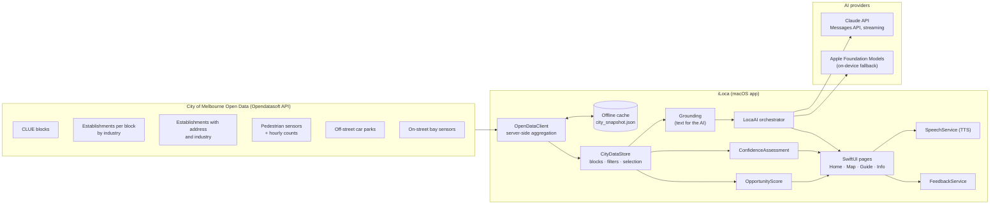

Design principles:

- **Numbers come from code, not AI.** The Opportunity Score, confidence, footfall and competition are calculated in Swift. The AI only explains them.
- **One source of truth.** `CityDataStore` holds the data, filters and selection. The map, detail panel, Info page, PDF report and AI grounding all read from it, so they always agree.
- **Honest gaps.** Missing data is shown as missing. For example, a block with no pedestrian sensor is never assumed to be quiet.

---

## 3. Data pipeline

### 3.1 Datasets

| # | Dataset (City of Melbourne) | API id | Used for |
|---|---|---|---|
| 1 | Blocks for Census of Land Use and Employment (CLUE) | `blocks-for-census-of-land-use-and-employment-clue` | Block id, area name and centre point |
| 2 | Business establishments per block by CLUE industry | `business-establishments-per-block-by-clue-industry` | Active businesses per block by industry (FnB, Retail, Services) |
| 3 | Business establishments with address and industry classification | `business-establishments-with-address-and-industry-classification` | Total and vacant premises per block; named businesses with addresses and map points |
| 4a | Pedestrian Counting System: sensor locations | `pedestrian-counting-system-sensor-locations` | Where each active sensor is |
| 4b | Pedestrian Counting System: hourly counts | `pedestrian-counting-system-monthly-counts-per-hour` | Average people per hour, weekday and weekend |
| 5 | Off-street car parks with capacity and type | `off-street-car-parks-with-capacity-and-type` | Public car parks (points and spaces); private spaces per block |
| 6 | On-street parking bay sensors | `on-street-parking-bay-sensors` | Live free/occupied status of sensor-fitted bays |

All are published under CC BY and fetched from `https://data.melbourne.vic.gov.au/api/explore/v2.1/`.

### 3.2 Launch sequence

Counting and averaging are done on the server with ODSQL `group_by` queries, so launch downloads a few hundred KB instead of the 400,000-row raw tables.

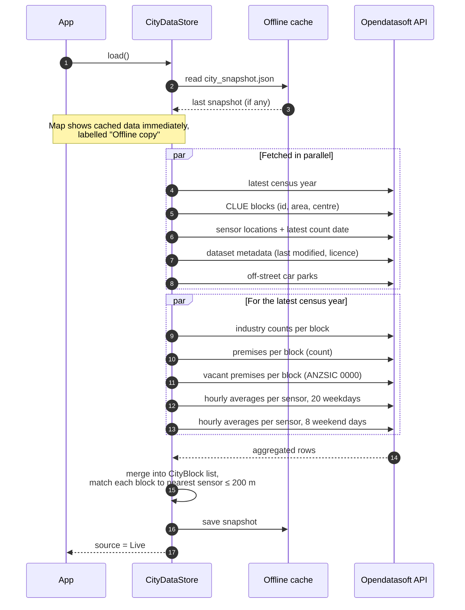

If the live fetch fails, the app keeps the cached snapshot and labels it **Offline copy**. The confidence of every block drops accordingly (see §6).

**On demand:**
- **Named businesses for a block** are fetched when the block is selected (one query filtered by `block_id`).
- **Live on-street parking** is fetched when the Parking tab or the parking overlay is shown, and refreshed every 5 minutes while the overlay is on. Only bays that reported in the last 24 hours are kept, since older rows are offline sensors.

### 3.3 Key queries

```text
# Vacant premises per block (dataset 3)
select   = block_id, count(*) as n
where    = census_year = date'2024' and industry_anzsic4_code = '0000'
group_by = block_id

# Average pedestrians per sensor per hour, over the weekday dates in the window (dataset 4b)
select   = location_id, hourday, avg(pedestriancount) as avg
where    = sensing_date = date'2026-10-15' or sensing_date = date'2026-10-14' or … (20 weekdays)
group_by = location_id, hourday

# Live bays (dataset 6)
select   = kerbsideid, status_description, status_timestamp, lastupdated, location
where    = lastupdated >= now(days=-1)
```

### 3.4 Foot-traffic window

The newest day of pedestrian counts is usually still being counted, so the window ends the day before it and covers the previous **28 days**, split into weekdays and weekend days. Dates are Melbourne calendar days and are always shown in Melbourne time, wherever the Mac is.

### 3.5 Block model

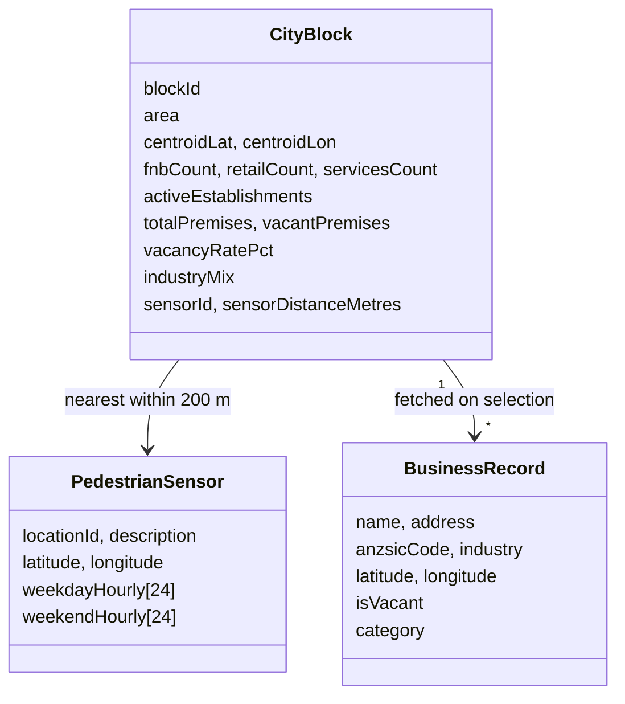

**Business type** is derived the same way from both datasets, so block counts and named businesses always agree:

| Type | ANZSIC | CLUE column |
|---|---|---|
| FnB | Subdivision 45 (food and beverage services) | `food_and_beverage_services` |
| Retail | Subdivisions 39–43 (retail trade) | `retail_trade` |
| Services | Everything else that is active | total − FnB − Retail |
| Vacant | Code `0000` | (not a business) |

---

## 4. Filters

Every filter changes something real. The Time of Day and Day Type filters feed directly into the score.

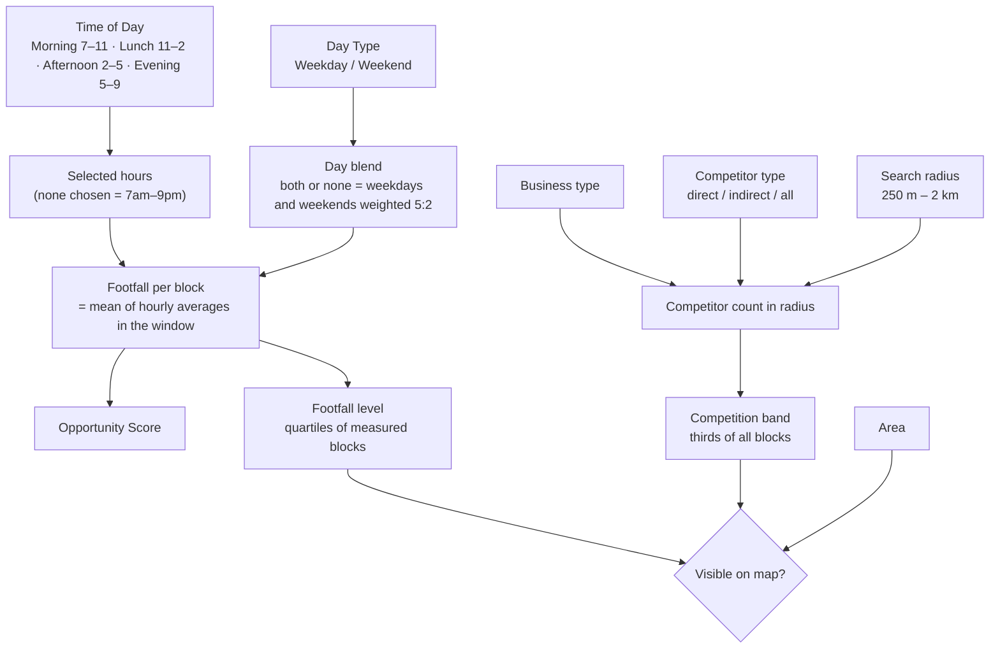

| Filter | What it does |
|---|---|
| **Business type** | Sets what counts as a direct competitor. It doesn't hide blocks. |
| **Area** | Shows only blocks in one CLUE area. |
| **Time of day / Day type** | Change which hours of pedestrian data are averaged. This changes footfall, the score and footfall levels. |
| **Footfall level** | Low / Medium / High / Very high = quartiles of measured blocks for the current window. Blocks without a sensor can't match a level, so they're hidden when a level is chosen. |
| **Competitor type** | Direct = same type as yours. Indirect = other active types. All = every active business. |
| **Search radius** | Radius for competitor counts, competitor markers and parking. |
| **Competition preference** | Low / Balanced / Established = bottom, middle and top third of blocks by competitor count. |

All per-block metrics are cached and only recalculated when a filter that affects them changes.

---

## 5. Opportunity Score

A 0–100 weighted score, computed in `Scoreengine.swift`.

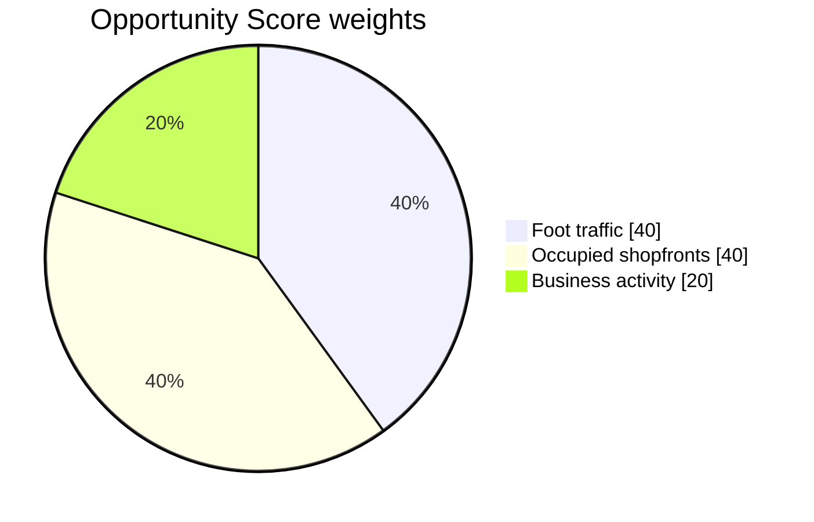

### 5.1 Factors

| Factor | Weight | Value (0–100) |
|---|---|---|
| Foot traffic | 40% | `min(100, footfall ÷ P90 × 100)`, where P90 is the 90th percentile of footfall across measured blocks for the same time window |
| Occupied shopfronts | 40% | `100 − vacancy rate %` |
| Business activity | 20% | `min(100, active businesses ÷ P95 × 100)`, where P95 is the 95th percentile of active businesses across all blocks |

Comparing against a high percentile rather than the maximum stops one outlier block from squashing everyone else's score.

### 5.2 Calculation flow

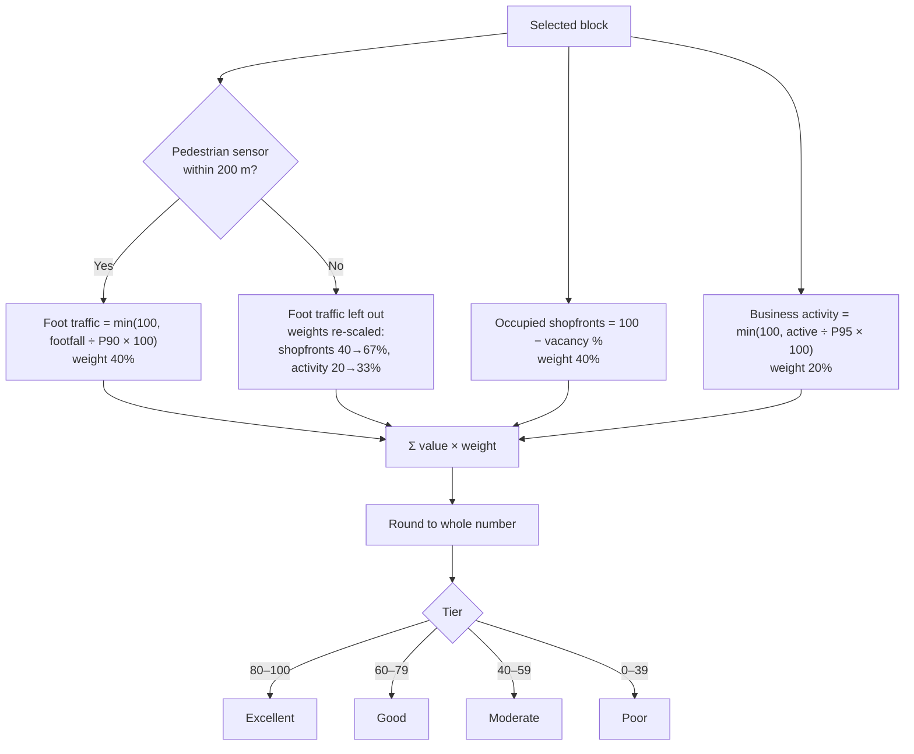

### 5.3 Worked examples

**Block 25, CBD Retail Core** (filters: FnB, lunch, all week)

| Factor | Inputs | Value | × Weight | Points |
|---|---|---:|---:|---:|
| Foot traffic | 919 people/hr vs P90 of 1,515 | 60.7 | × 0.40 | 24.3 |
| Occupied shopfronts | 79 of 298 vacant (26.5%) | 73.5 | × 0.40 | 29.4 |
| Business activity | 219 active vs P95 of 136 | 100 (capped) | × 0.20 | 20.0 |
| **Total** | | | | **73.7 → 74 (Good)** |

**Block 82, CBD West** (filters: none, so 7am–9pm, all week)

| Factor | Inputs | Value | × Weight | Points |
|---|---|---:|---:|---:|
| Foot traffic | 287 people/hr vs P90 of 1,118 | 25.7 | × 0.40 | 10.3 |
| Occupied shopfronts | 39 of 119 vacant (32.8%) | 67.2 | × 0.40 | 26.9 |
| Business activity | 80 active vs P95 of 136 | 58.8 | × 0.20 | 11.8 |
| **Total** | | | | **49.0 → 49 (Moderate)** |

**A block with no sensor** (illustrative)

| Factor | Value | Re-scaled weight | Points |
|---|---:|---:|---:|
| Foot traffic | not available | 0% | 0 |
| Occupied shopfronts | 80 | 0.4 ÷ 0.6 = 66.7% | 53.3 |
| Business activity | 40 | 0.2 ÷ 0.6 = 33.3% | 13.3 |
| **Total** | | | **66.7 → 67 (Good)** |

Because P90 depends on the time window, changing Time of Day or Day Type changes every block's foot-traffic factor. Lunch has a higher P90 than 7am–9pm, so the same block can score differently.

---

## 6. Confidence level

Confidence measures **how well the data supports a score**, not how good the location is. It's a 100-point rubric in `ConfidenceEngine.swift`.

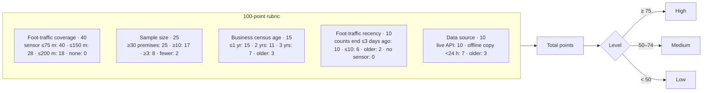

Why these factors:

| Factor | Why it matters |
|---|---|
| Foot-traffic coverage | Foot traffic is 40% of the score. A distant sensor may not reflect the block. |
| Sample size | Vacancy rates on blocks with very few premises are noisy (1 vacancy in 3 premises is 33%). |
| Census age | The CLUE census is annual, so shops open and close between updates. |
| Foot-traffic recency | Older counts may miss recent changes. |
| Data source | An offline copy may be out of date. |

### 6.1 Worked examples

```mermaid
xychart-beta
    title "Block 82 confidence: points earned vs available"
    x-axis ["Coverage", "Sample", "Census age", "Recency", "Source"]
    y-axis "Points" 0 --> 40
    bar [40, 25, 15, 10, 10]
    bar [28, 25, 11, 10, 10]
```

*Taller bar: points available. Shorter bar: points earned.*

| Factor | Block 25 | Block 82 |
|---|---|---|
| Foot-traffic coverage | Sensor 56 m away → **40**/40 | Sensor 103 m away → **28**/40 |
| Sample size | 298 premises → **25**/25 | 119 premises → **25**/25 |
| Census age | 2024 census, 2 years old → **11**/15 | **11**/15 |
| Foot-traffic recency | Counts to 15 Oct → **10**/10 | **10**/10 |
| Data source | Live → **10**/10 | **10**/10 |
| **Total** | **96 → High** | **84 → High** |

On the map, blocks with **Low** confidence are drawn as hollow pins.

---

## 7. Competition and parking

### 7.1 Competition

For each block, iLoca adds up competitors in every block whose centre lies within the search radius, including the block itself:

| Competitor type | Counted per block |
|---|---|
| Direct | Businesses of your type (e.g. FnB) |
| Indirect | Active businesses that are *not* your type |
| All | All active businesses |

Example: Block 25 with FnB and 500 m gives **577 FnB rivals within 500 m**. With a block selected, nearby competitor blocks appear on the map as numbered rings, and the dashed circle shows the radius.

Distances are measured between block centres (haversine formula), not between individual shopfronts.

### 7.2 Parking (context only, not scored)

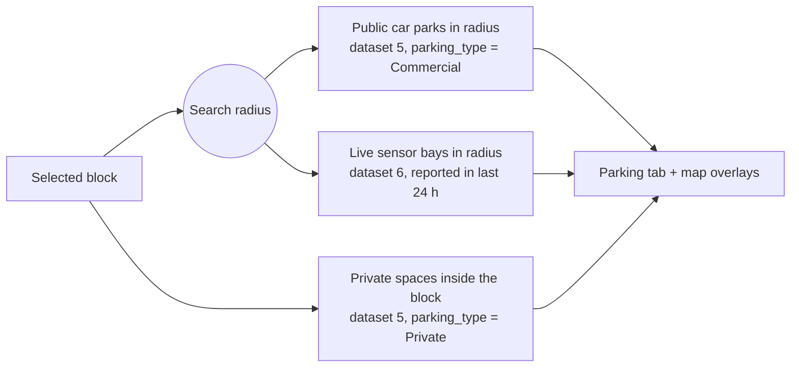

Example (Block 25, 500 m): 24 public car parks with 7,643 spaces, plus 81 private spaces inside the block. Live bay counts change by the minute.

---

## 8. Loca, the AI assistant

### 8.1 Which model answers

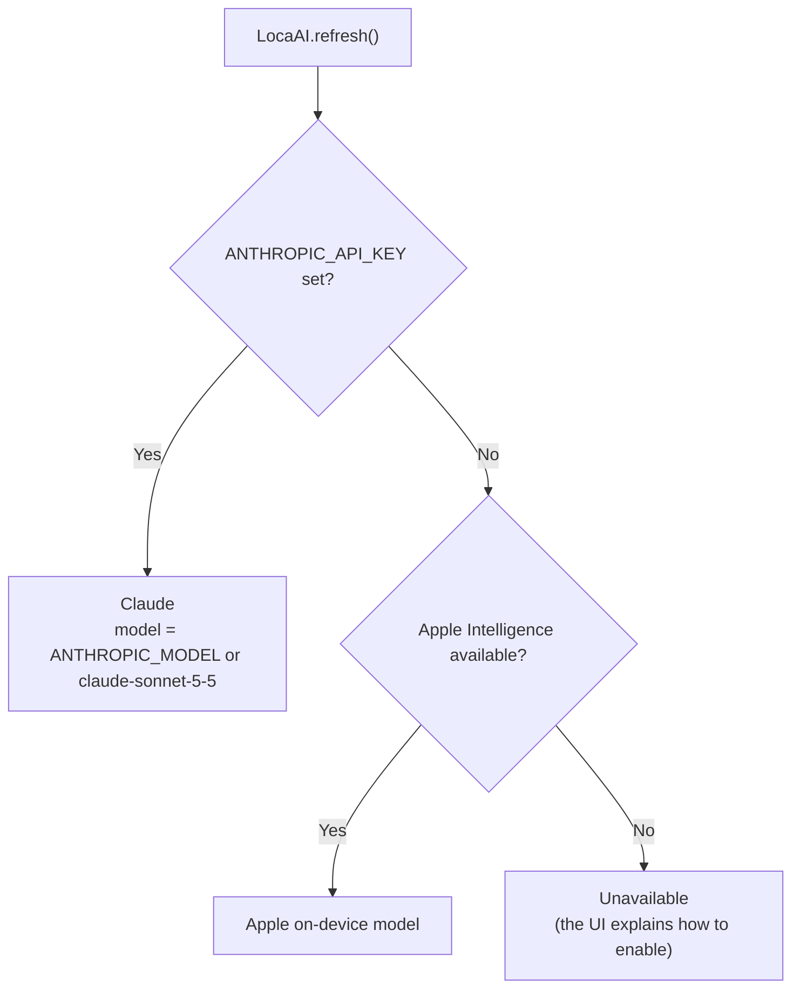

### 8.2 Grounding

The AI never sees raw API rows. `Grounding` turns the same numbers shown on screen into plain text:

- **Block facts:** premises, vacancies, counts by type, industry mix.
- **Foot traffic:** the sensor and its distance, the value for the selected window, weekday and weekend peaks, hourly averages, and the dates averaged.
- **Opportunity Score:** each factor with its value, applied weight and explanation.
- **Competition:** competitors within the radius and which third of blocks they fall in.
- **Parking:** car parks, private spaces and live free bays.
- **Confidence:** the level, points and each factor.
- **Named businesses and vacant addresses.**
- **What is not available:** rents, leases, revenue, public transport, demographics, zoning.

It also adds shared rules (`LocaAI.sharedRules`):
- Loca gives decision support, not professional advice.
- Never invent figures.
- Say plainly when something isn't in the data.
- Coverage is the City of Melbourne only.
- Location data doesn't confirm zoning.
- Answers are short, in plain Australian English.

The on-device model gets a **compact** version of the grounding, because its context window is much smaller.

### 8.3 Request flow

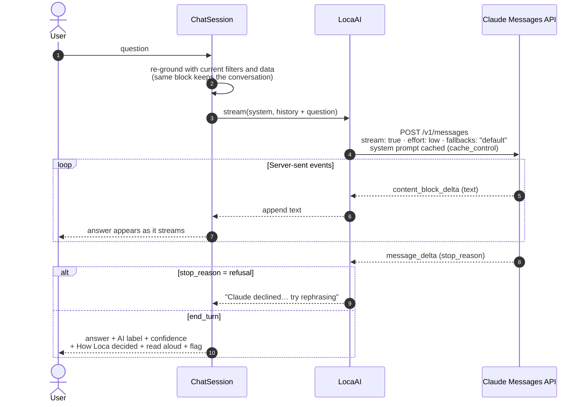

Details:
- **Streaming:** the Messages API is called directly over `URLSession`, since Swift has no official Anthropic SDK. Only `text_delta` events are shown; thinking and other blocks are ignored.
- **Refusal fallback:** `fallbacks: "default"` (beta header `server-side-fallback-2026-07-01`) lets Anthropic retry a declined request on another model within the same call. A refusal still returns HTTP 200, so the app checks `stop_reason` before trusting the text.
- **Prompt caching:** the system prompt (instructions plus block data) is marked `cache_control: ephemeral`, so follow-up questions about the same block reuse it.
- **Effort:** `low` for chat, `medium` for the PDF report narrative.
- **History:** completed question and answer pairs are sent back each turn. Failed answers are left out so the model never sees its own error messages.

### 8.4 Chat lifecycle (ephemeral)

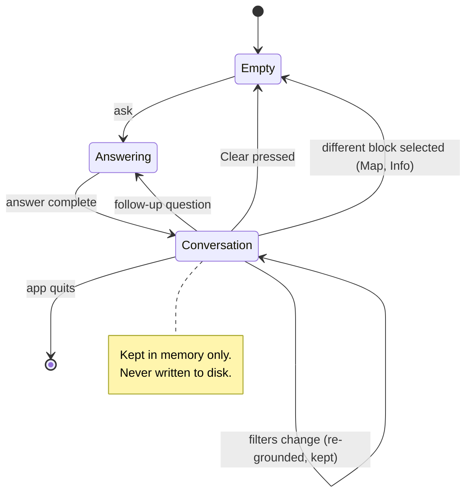

When Claude is enabled, questions and the block data go to Anthropic's API. Anthropic's API data-retention policy applies to that data.

---

## 9. Guide assistant

The Guide page answers questions from four official guides bundled as PDFs: Plan, Setup, Budget and Grow.

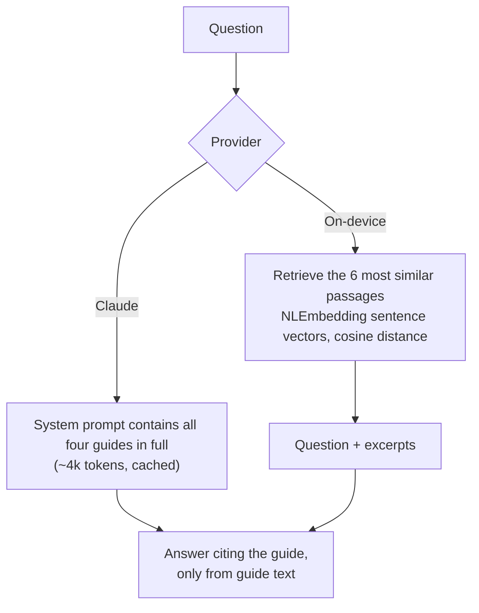

The PDFs are split into passages of about 500 characters by grouping lines, because these PDFs have no blank lines between paragraphs. Each passage is embedded on-device once, when the page first loads.

---

## 10. Responsible AI features

| Principle | Feature | Where |
|---|---|---|
| Transparency | Score breakdown, confidence checklist, methodology | Block panel, Info dashboard |
| Transparency | AI label naming the model on every answer, plus a disclosure banner on every chat | `ChatComponents.swift` |
| Explainability | "How Loca decided": sources, confidence and the calculation behind each answer | Under each answer |
| Accountability | **Report an issue**: incorrect data, misleading recommendation, unexpected AI behaviour | Info page corner, flag under any answer, block panel |
| Privacy | Ephemeral chats; the API key comes from the environment and is never stored by the app | `ChatSession`, `LocaAI` |
| Accessibility | Read aloud, using on-device speech in an Australian English voice | Speaker button under each answer |
| Reliability | Grounded prompts, refusal handling, offline cache, Melbourne-time dates | Throughout |

**Report an issue** saves a JSON file locally, in the app's Application Support folder under `iLoca/Issue Reports`. It holds the issue type, your description and optionally the context (block, score, confidence, the flagged question and answer, model, data freshness). You can share, copy or reveal the file; nothing is uploaded automatically.

**Read aloud** tidies the text before speaking it: markdown symbols are dropped, and units are expanded ("919 people/hr" becomes "919 people per hour", "56 m" becomes "56 metres", "74/100" becomes "74 out of 100").

---

## 11. PDF reports

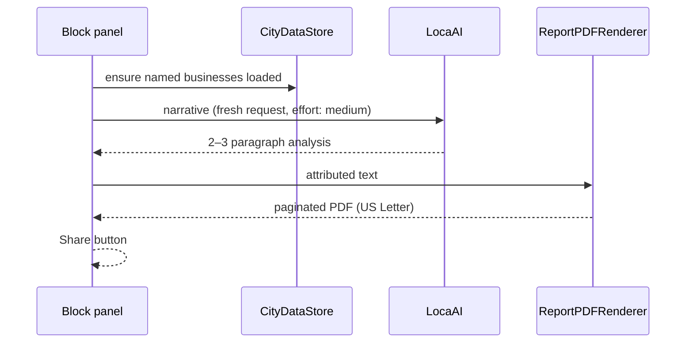

Report contents:
- the AI analysis, labelled with the model that wrote it
- the score and its factor breakdown
- confidence and its factors
- key stats
- parking
- the filters applied
- the industry mix
- named businesses and vacant premises
- data sources with update dates and licences
- limitations

---

## 12. Appearance

Light, Dark or Match System, from the button at the right of the top nav. The choice is stored in `UserDefaults` (`appearance`), and dark is the default.

Every theme colour in `Theme.swift` and `Mapcolors.swift` has a light and a dark value and switches automatically (`Color(light:dark:)`). Text uses `AppColor.textPrimary`. White is used only for text on coloured badges.

---

## 13. Testing

Run with **⌘U** in Xcode.

| Suite | What it checks |
|---|---|
| `ScoringTests` | Score weights, re-weighting when there's no sensor, capping, confidence rubric, 5:2 weekday/weekend blend, time-of-day hours, percentiles, ANZSIC mapping |
| `LiveDataTests` | Live API: all datasets load, and the counts from datasets 2 and 3 agree for Block 25 |
| `ParkingTests` | Live bays load, are unique and recent, and add up correctly per block |
| `ClaudeStreamParserTests` | Recorded SSE streams: text only, refusal, error and fallback blocks |
| `ReportTests` | PDF renders from live data |
| `RegressionTests` | Melbourne-day display regardless of the Mac's time zone; guide chunking |
| `SpeechTests` | Speech text clean-up, Australian voice available, play then stop |
| `ChatPipelineTests` | End to end: live data → grounding → model → answer |
| `ClaudeAccuracyTests` | 12 real questions to Claude, each checked against ground truth, with a flag for any number not present in the grounding (paid calls; skipped without a key) |

`ClaudeAccuracyTests` writes every question, answer and ground truth to `iloca_claude_accuracy.txt` in the test's temporary directory for manual review.

---

## 14. Code map

| File | Responsibility |
|---|---|
| `iLocaApp.swift` | App entry; applies the appearance |
| `RootScrollContainer.swift` | Page scroller, floating Loca button, report-issue sheet, debug launch arguments |
| `TopNavBar.swift` | Nav bar and appearance menu |
| `Landingview.swift` | Home page |
| `ContentView.swift` | Map page and map overlays |
| `MapSidebar.swift` | Filters, block search, overlay toggles |
| `Mapdetailpanel.swift` | Block panel: score, confidence, stats, Traffic / Rivals / Vacant / Parking tabs, report |
| `GuidesView.swift`, `Guide*.swift` | Guide page, guide PDFs, retrieval |
| `InfoView.swift` | Info dashboard |
| `Models.swift` | Data types, dataset list, Melbourne-time formatting |
| `OpenDataClient.swift` | Opendatasoft API queries and aggregation |
| `CityDataStore.swift` | Shared state, filters → metrics, competition, parking, offline cache |
| `Scoreengine.swift` | Opportunity Score |
| `ConfidenceEngine.swift` | Confidence rubric |
| `Mapfilterstatel.swift` | Filter state and enums |
| `BusinessCategory.swift` | FnB / Retail / Services mapping |
| `ClaudeClient.swift` | Messages API client and SSE parser |
| `LocaAI.swift` | Provider selection and streaming for Claude and on-device |
| `ChatSession.swift` | Ephemeral conversations |
| `LocationAdvisorAI.swift` | Grounding text and the Map advisor |
| `Guidesadvisorai.swift` | Guide advisor |
| `Methodology.swift` | Methodology text and the Info assistant |
| `ChatComponents.swift` | Chat UI: bubbles, disclosure, read aloud, How Loca decided |
| `ScoreCards.swift` | Score and confidence cards |
| `SpeechService.swift` | Text-to-speech |
| `FeedbackService.swift`, `ReportIssueSheet.swift` | Report an issue |
| `ReportGenerator.swift`, `ReportDocumentBuilder.swift`, `ReportPDFRenderer.swift` | PDF reports |
| `Theme.swift`, `Mapcolors.swift` | Colours, fonts, appearance |

---

## 15. Configuration

| Setting | Where | Default |
|---|---|---|
| `ANTHROPIC_API_KEY` | Xcode › Product › Scheme › Edit Scheme › Run › Arguments › Environment Variables | none (falls back to the on-device model) |
| `ANTHROPIC_MODEL` | same place | `claude-sonnet-5-5` |
| Appearance | top-nav button | Dark |

Per-user schemes live in `xcuserdata/`, which is git-ignored, so the key is never committed. Environment variables only reach the app when it's launched from Xcode.

**Debug launch arguments** (Debug builds only), for screenshots and QA:

```text
-iLocaPage Map|Info|Guide|Home   -iLocaBlock 25   -iLocaCategory FnB|Retail|Services
-iLocaTime Morning|Lunch|Afternoon|Evening   -iLocaParking YES   -iLocaFootfallZones YES
-iLocaAsk "question"   -appearance light|dark|system
```

---

## 16. Limitations

- Coverage is the **City of Melbourne municipality** only.
- Business and vacancy figures come from the **annual CLUE census**, so recent openings and closures may be missing.
- **Pedestrian sensors** mainly cover the CBD and main streets. Most blocks elsewhere have no foot-traffic reading.
- **Distances** are between block centres, not individual shopfronts.
- **On-street parking** covers sensor-fitted bays only.
- There is **no rent, lease, listing, public transport, demographic or zoning data**. A good score doesn't confirm a premises is permitted for a particular use, so check with the City of Melbourne planning team.
- Loca gives **decision support**. It isn't financial, legal or planning advice and can't guarantee business success.
